# LDK Al-Fath Telkom University — Website Profil & Artikel

### Minggu ke-2 (W2) — Struktur HTML tanpa CSS

Fokus: kerangka semantik semua halaman, belum ada styling.

| File         | Halaman                                  | Screenshot                              |
| ------------ | ---------------------------------------- | --------------------------------------- |
| `w2_1.png` | Beranda (`index.html`) polos           | 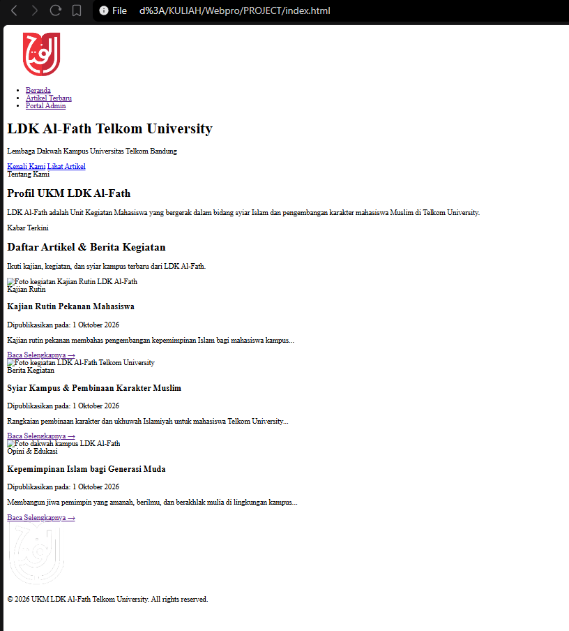 |
| `w2_2.png` | Detail artikel (`artikel.html`) polos  | 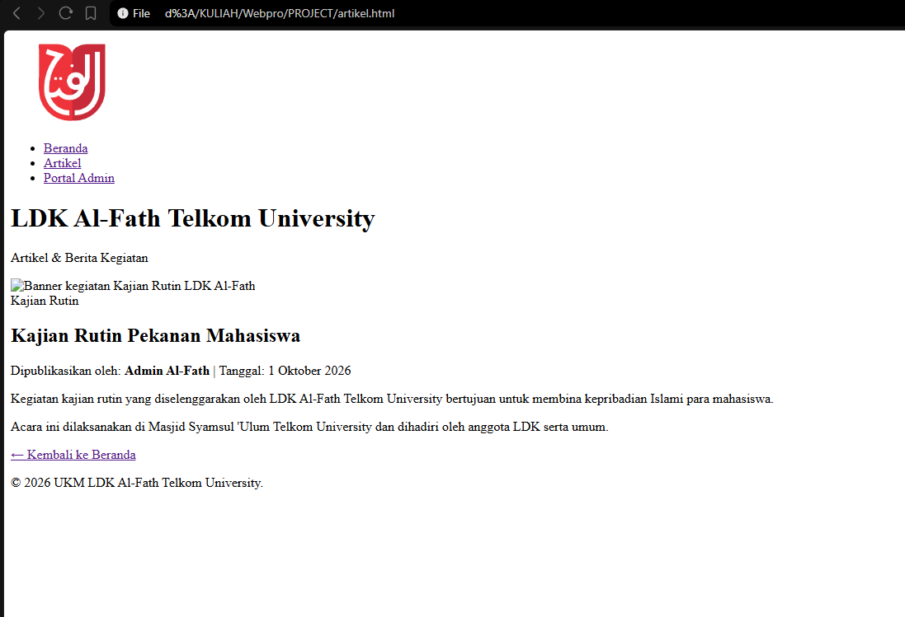 |
| `w2_3.png` | Panel admin (`form-upload.html`) polos | 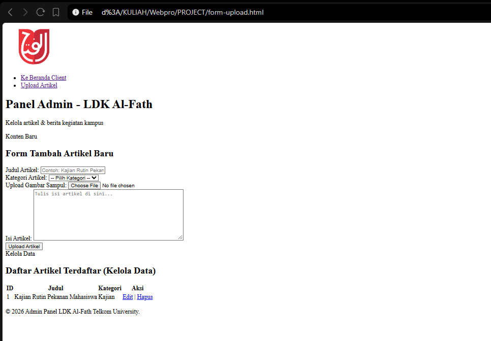   |

Minggu ke-3 (W3) — Styling Pure CSS + Responsive

**1. Beranda**

| Desktop                                         | Mobile (responsive)                             |
| ----------------------------------------------- | ----------------------------------------------- |
| 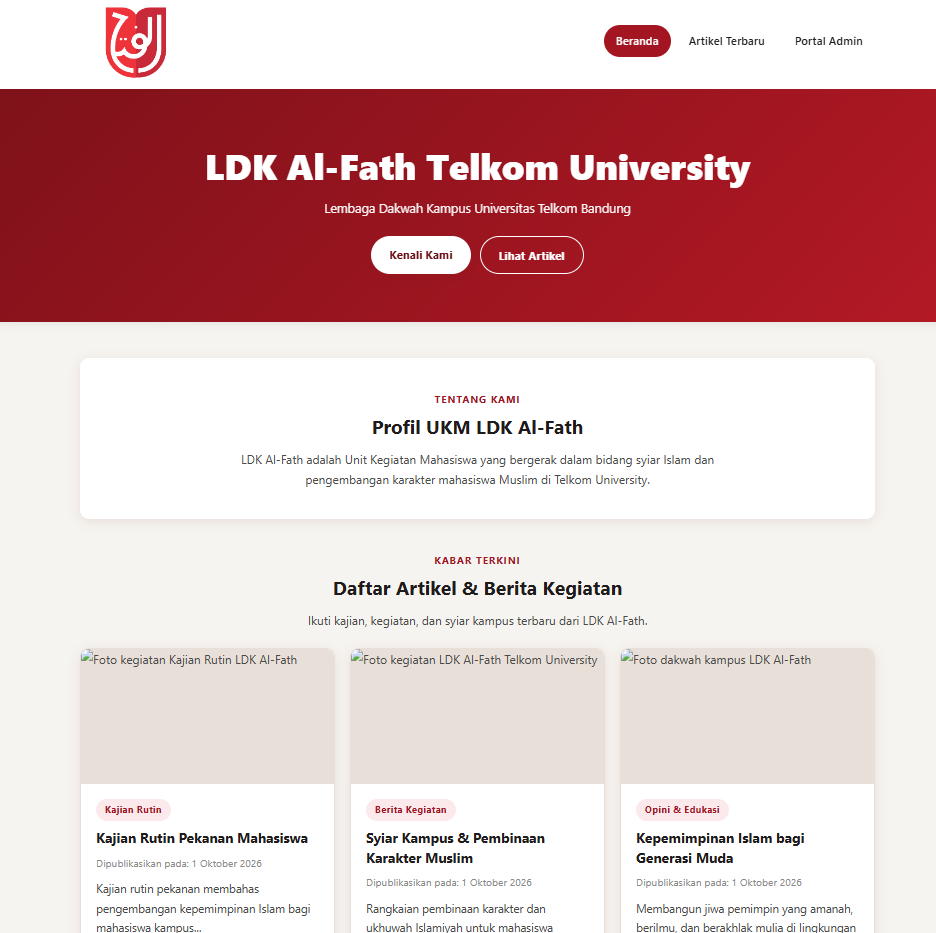 | 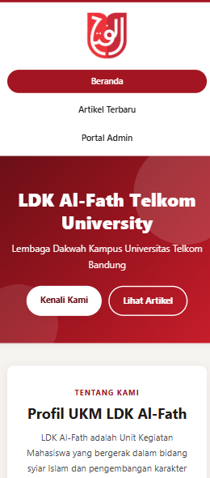 |

**2. Detail Artikel**

| Desktop                                         | Mobile (responsive)                             |
| ----------------------------------------------- | ----------------------------------------------- |
| 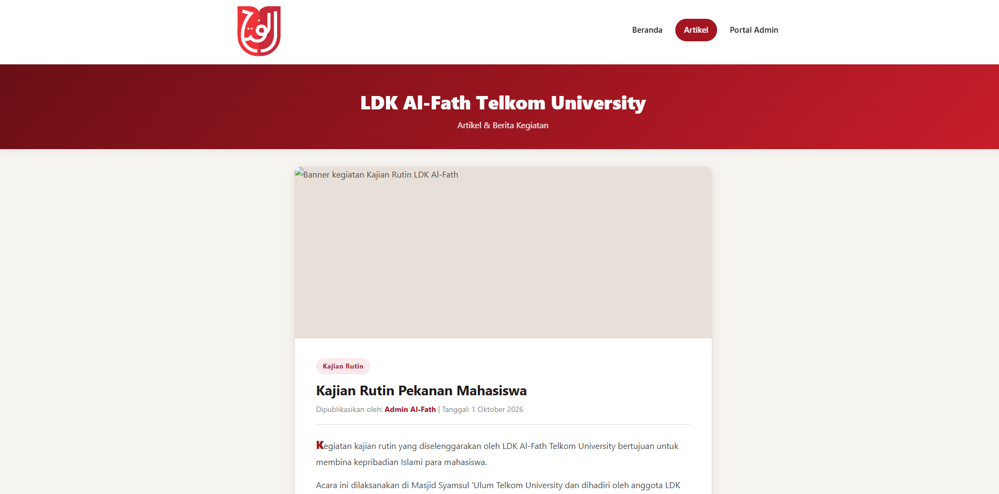 | 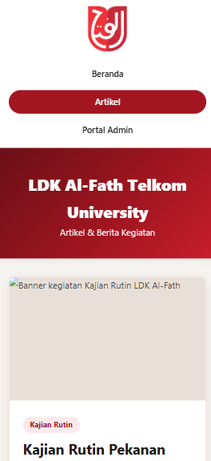 |

**3. Panel Admin**

| Desktop                                       | Mobile (responsive)                           |
| --------------------------------------------- | --------------------------------------------- |
| 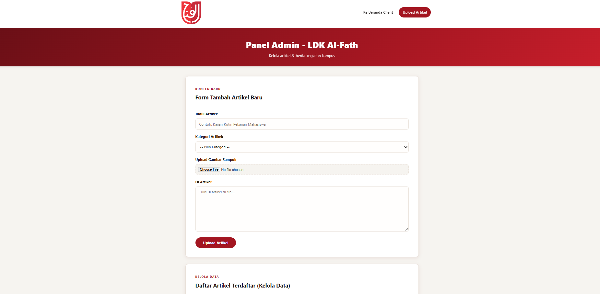 | 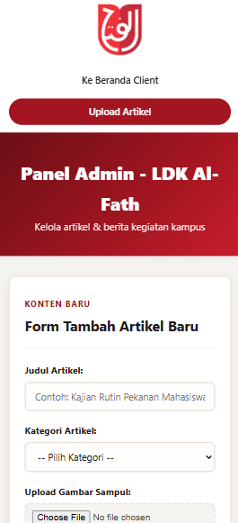 |

### Minggu ke-4 (W4) — Refactor Tailwind CSS + Kerangka Halaman Responsif

Fokus: migrasi dari pure CSS (`style/*.css` jadi arsip) ke Tailwind CDN Play dengan
kustomisasi leluasa (`tailwind.config` inline: `alfath-maroon #9B1C1C`).
Belum terhubung ke backend/database — semua data masih dummy statis.

| File | Halaman | Fungsi syarat tugas |
| ---- | ------- | ------------------- |
| `index.html` | Beranda publik | Dashboard/grid utama publik: stat `grid-cols-1 sm:2 xl:4` + artikel `1 / md:2 / lg:3` |
| `dashboard.html` | Dashboard admin | Grid admin: 4 kartu statistik + `lg:grid-cols-3` (tabel ringkas + aktivitas) |
| `data.html` | Daftar data | Tabel responsif `overflow-x-auto` + search/filter/pagination dummy (pisahan dari form) |
| `form-upload.html` | Form tambah artikel | Form tambah data: judul, kategori, tanggal, file, textarea |
| `login.html` | Form login | Form login centered `max-w-sm` (dummy → `dashboard.html`) |
| `artikel.html` | Detail artikel | Detail + `<ul>` list info kegiatan |

Navigasi responsif:

- Publik (`index.html`, `artikel.html`): navbar atas `sticky`, `hidden md:flex`, hamburger → toggle `#nav-mobile`.
- Admin (`dashboard.html`, `data.html`, `form-upload.html`): sidebar `fixed -translate-x-full lg:translate-x-0` + overlay + topbar hamburger.
- Login: tanpa nav, hanya link kembali.

Uji responsif (minimal 2 ukuran, kami uji 3):

- 375px mobile: 1 kolom, drawer nav, tabel scroll horizontal.
- 768px tablet: 2 kolom kartu/artikel, toolbar mulai row.
- 1280px desktop: 4 kolom kartu, sidebar permanen.

Cara jalankan: buka file `.html` langsung di browser atau `npx serve .`.

**1. Beranda (`index.html`) — Tailwind**

| Desktop                                         | Mobile (responsive)                           |
| ----------------------------------------------- | --------------------------------------------- |
| 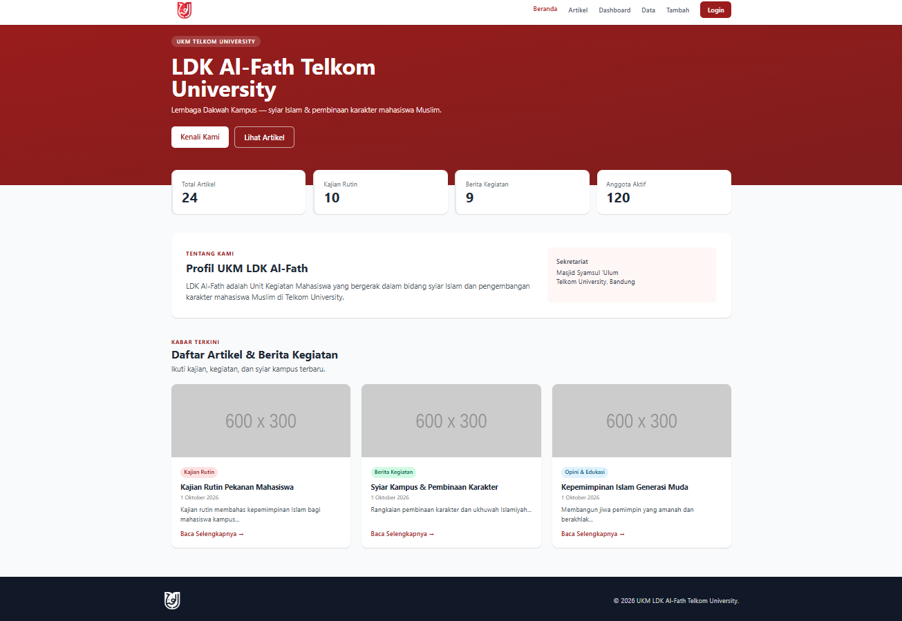 | 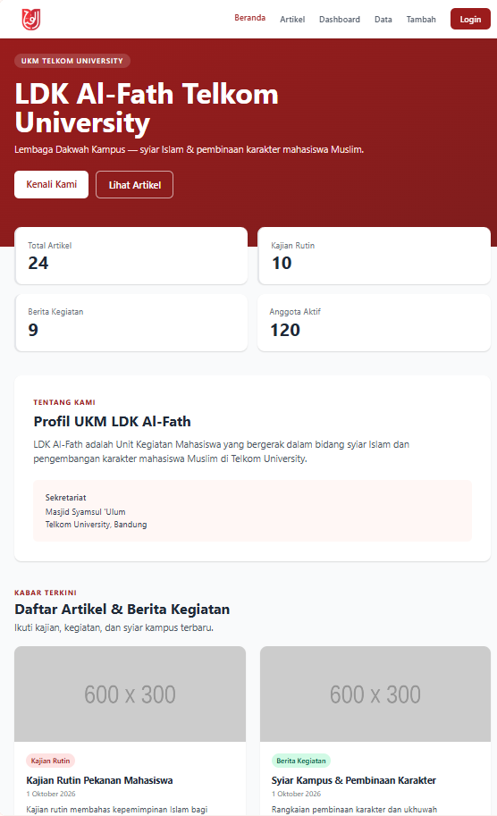 |

**2. Data Artikel (`data.html`) — Tailwind + Sidebar**

| Desktop                                       | Mobile (responsive)                         |
| --------------------------------------------- | ------------------------------------------- |
| 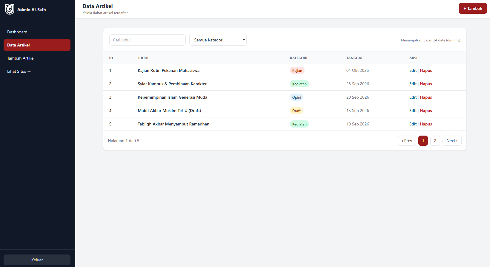 | 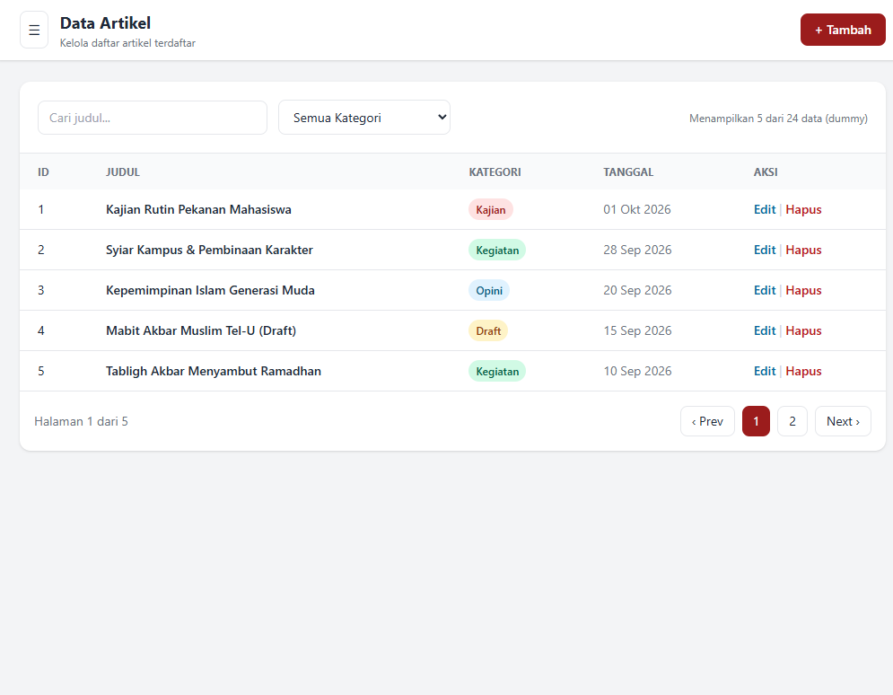 |

**3. Login (`login.html`) — Tailwind**

| Desktop                                     |
| ------------------------------------------- |
| 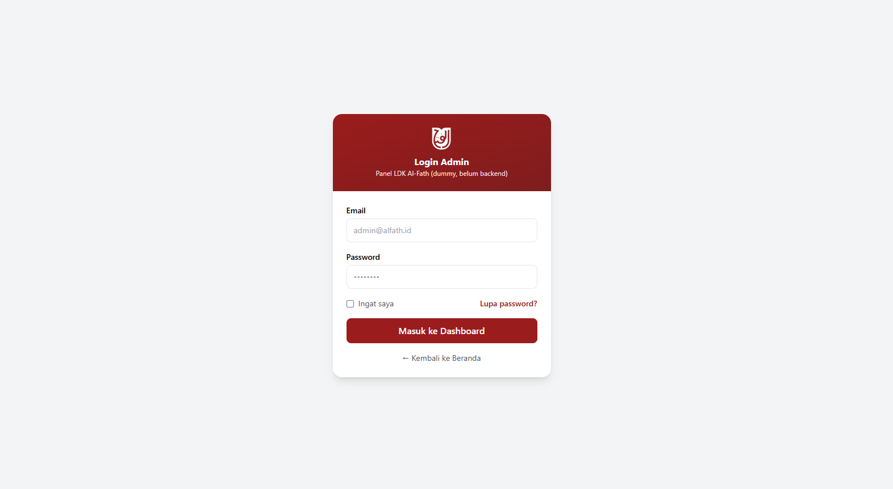 |

### Minggu ke-5 (W5) — Interaktivitas JavaScript dan jQuery

**Studi kasus:** pengelolaan artikel kajian, berita kegiatan, dan opini LDK Al-Fath Telkom University.
Halaman admin melanjutkan HTML + Tailwind W4; data dummy diproses di browser tanpa backend/database.

#### Cara menjalankan W5

Dari folder repository, jalankan:

```bash
python -m http.server 8000 --bind 127.0.0.1
```

Buka **http://127.0.0.1:8000/dashboard.html**, lalu gunakan menu Data Artikel dan Tambah Artikel.
Gunakan alamat/port yang sama selama demo agar ketiga halaman membaca localStorage yang sama.
Koneksi internet diperlukan untuk Tailwind CDN dan **jQuery full 3.7.1**.

#### Fitur yang sudah aktif

- **Data Artikel:** tabel hasil render JavaScript, pencarian judul tanpa membedakan kapital, filter kategori gabungan, dan pagination 5 artikel per halaman.
- **Detail:** panel isi artikel dibuka dengan `slideToggle()`; tombol Tutup/Escape mengembalikan fokus ke pemicu.
- **Tambah artikel:** validasi field kosong/spasi, kategori, tanggal, serta PNG/JPG maksimal 2 MB; notifikasi menggunakan `fadeIn()`.
- **Hapus artikel:** konfirmasi sebelum penghapusan, jumlah hasil dan pagination diperbarui.
- **Dashboard:** total artikel, jumlah kategori, jumlah draft, dan tiga artikel terbaru dihitung dari data yang sama.
- **Penyimpanan lokal:** perubahan bertahan setelah refresh dan tersinkron antartab pada origin yang sama.
- **Reset Data Demo:** mengembalikan 8 artikel awal setelah konfirmasi; berguna untuk mengulang demonstrasi.
- **Responsif dan keyboard:** sidebar mobile, fokus validasi, label field, status ARIA, dan dukungan reduced motion.

Kategori dipisahkan dari status: **Draft bukan kategori**, melainkan artikel yang belum dipublikasikan.
Artikel dari form berstatus **Terbit**. Upload masih simulasi: hanya nama file disimpan sebagai metadata,
bukan isi gambar. Data admin W5 belum mengubah konten statis halaman publik W4.

#### Pemetaan ke instruksi tugas

| Syarat | Implementasi | Lokasi |
| --- | --- | --- |
| Variabel dan tipe data dasar | Array of object 8 artikel: number `id`, string judul/kategori/tanggal/isi, boolean `dipublikasikan` | `article-data.js`: `getInitialArticles()` |
| Function pemrosesan data | Pencarian/filter, pengurutan tanggal, pagination, dan perhitungan statistik | `filterArticles()`, `sortArticles()`, `paginateArticles()`, `getArticleStats()` |
| Percabangan/perulangan dan render dinamis | `if` empty state serta `for...of` untuk membangun baris tabel melalui DOM JavaScript murni | `script.js`: `renderArticleTable()`, `createArticleRow()` |
| Efek jQuery | `slideToggle()` detail, `fadeIn()` notifikasi, `show()`/`hide()` pesan | `handleDetailClick()`, `showNotification()` |
| Event jQuery | `.on('submit', ...)`, `.on('input', ...)`, `.on('change', ...)`, dan delegasi `.on('click', ...)` untuk tombol dinamis | `bindEvents()` |
| Validasi client-side | `preventDefault()`, cek field/whitespace, tanggal, tipe/ukuran gambar, pesan inline | `handleFormSubmit()`, `validateArticleInput()` |
| Relevansi studi kasus | Pengelolaan artikel dakwah dan kegiatan kampus Al-Fath | Tiga halaman admin yang sudah ada |

#### Struktur kode dan clean code

| File | Tanggung jawab |
| --- | --- |
| `article-data.js` | Model data dummy dan fungsi domain murni; juga dapat diuji melalui Node |
| `script.js` | Boundary localStorage, render DOM, event jQuery, sidebar, serta inisialisasi sesuai halaman |
| `style/w5.css` | State validasi, fokus, notifikasi, dan reduced motion; melengkapi Tailwind W4 |
| `tests/article-data.test.js` | Pengujian perilaku data, validasi, pagination, dan payload penyimpanan |

Setiap fungsi diberi komentar di atasnya. Nama fungsi menjelaskan tujuan, fungsi difokuskan pada satu
tanggung jawab, dan teks dari pengguna dirender memakai `textContent`. Kegagalan penyimpanan ditampilkan
di antarmuka sebagai mode sementara; data tidak diklaim tersimpan jika browser menolak penulisan.
Key penyimpanan: `alfath.articles.w5.v1`. Menghapus seluruh artikel menghasilkan daftar kosong yang tetap
dipertahankan saat refresh, bukan otomatis memuat seed lagi.

#### Screenshot sebelum dan sesudah interaksi

**1. Pencarian dan filter kategori**

| Sebelum: semua artikel | Sesudah: kata kunci kajian + kategori Kajian Islam |
| --- | --- |
| 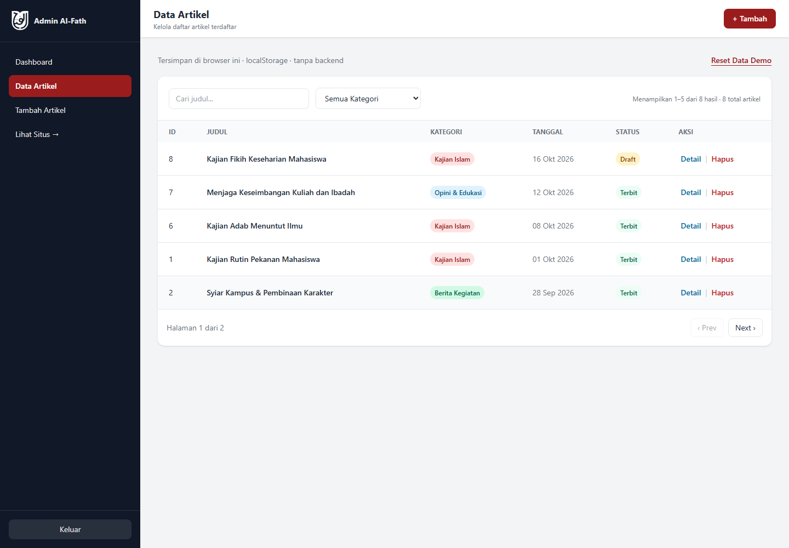 |  |

**2. Efek tampil/sembunyi detail artikel**

| Sebelum: detail tertutup | Sesudah: detail ditampilkan |
| --- | --- |
| 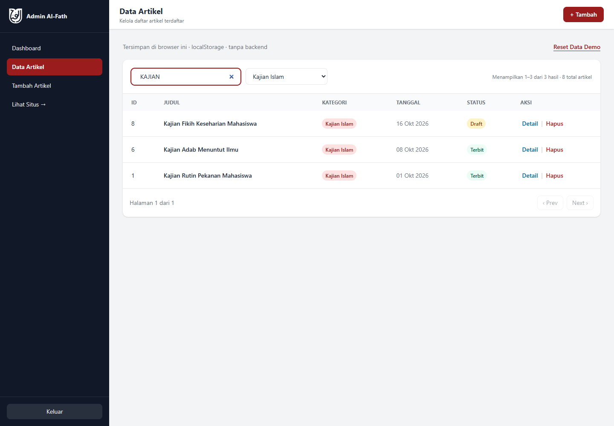 | 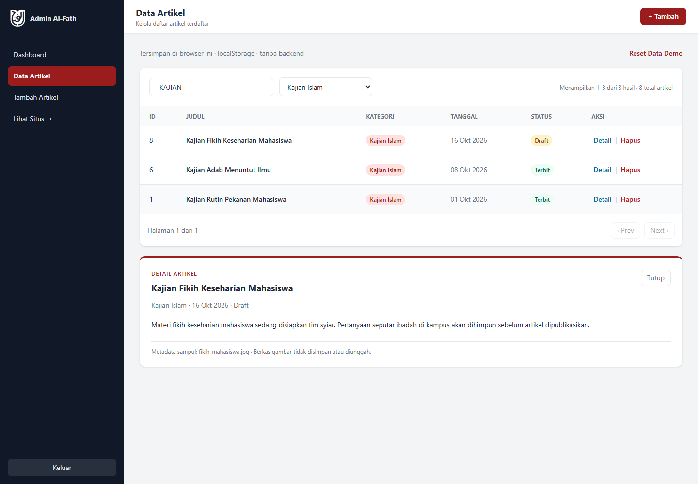 |

**3. Validasi submit form kosong**

| Sebelum submit | Sesudah submit: pesan error tiap field |
| --- | --- |
| 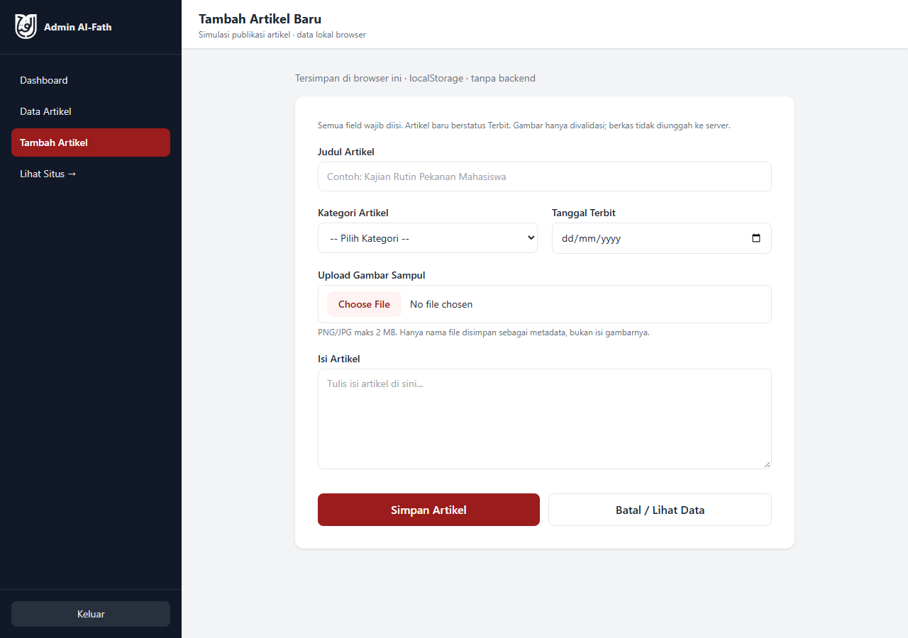 | 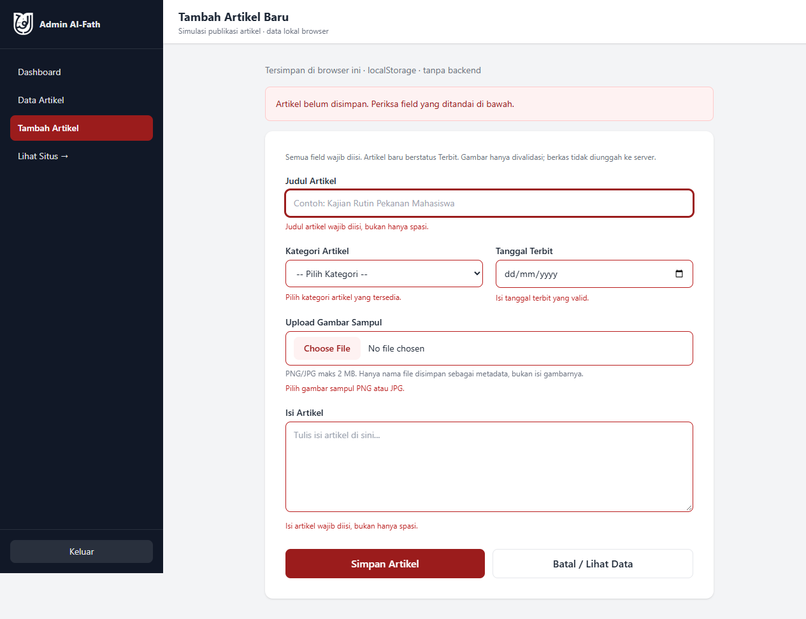 |

**4. Penambahan artikel dari form**

| Sebelum: 8 artikel | Sesudah: 9 artikel, artikel baru tampil di atas |
| --- | --- |
| 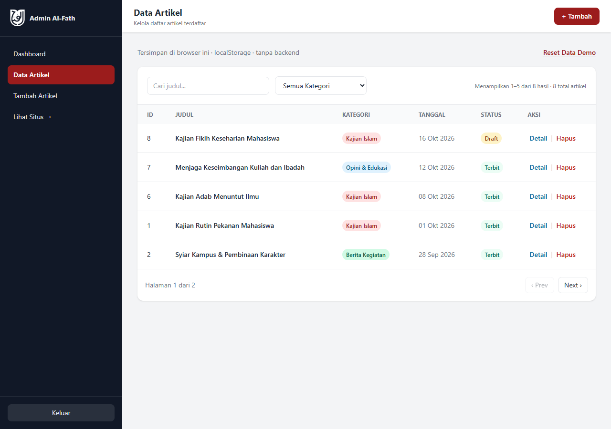 | 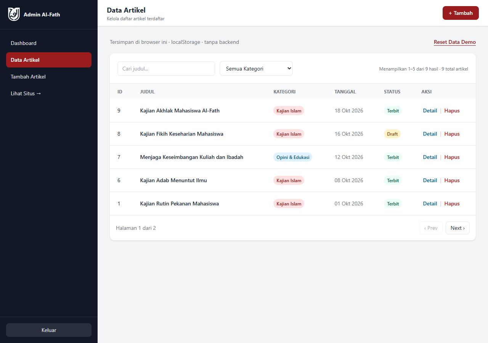 |

**5. Dashboard dan tampilan mobile**

| Dashboard setelah penambahan | Data Artikel di mobile (375 px) |
| --- | --- |
| 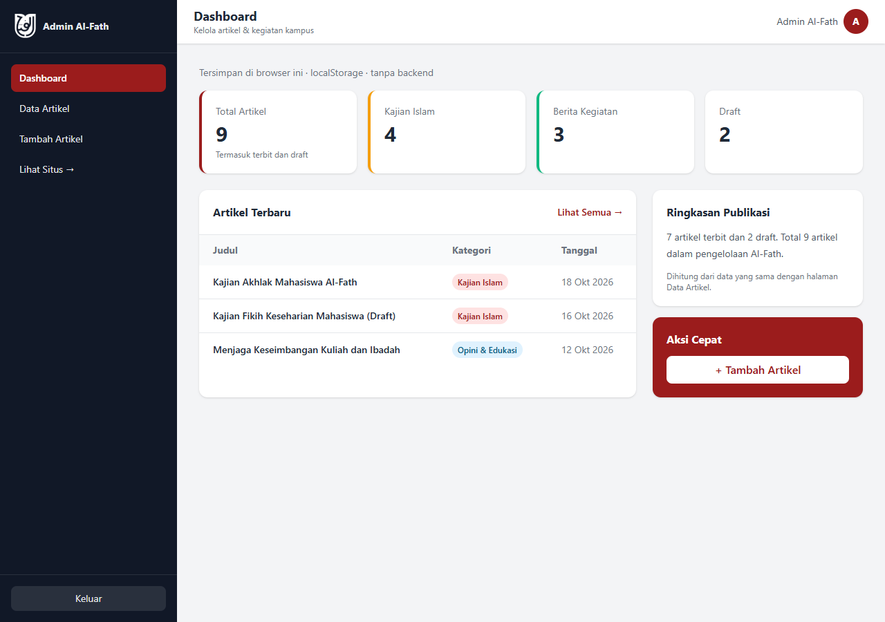 | 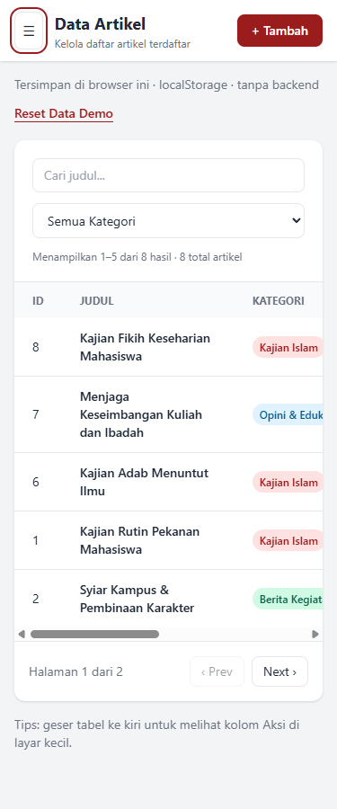 |

Bukti tambahan: [notifikasi sukses form](assets/progress/w5_form_success.png) dan
[hasil penghapusan artikel](assets/progress/w5_delete.png).

#### Video
**[Tonton/unduh video demo W5 — WebM, ±53 detik](docs/screenshots/w5-demo.webm)**
